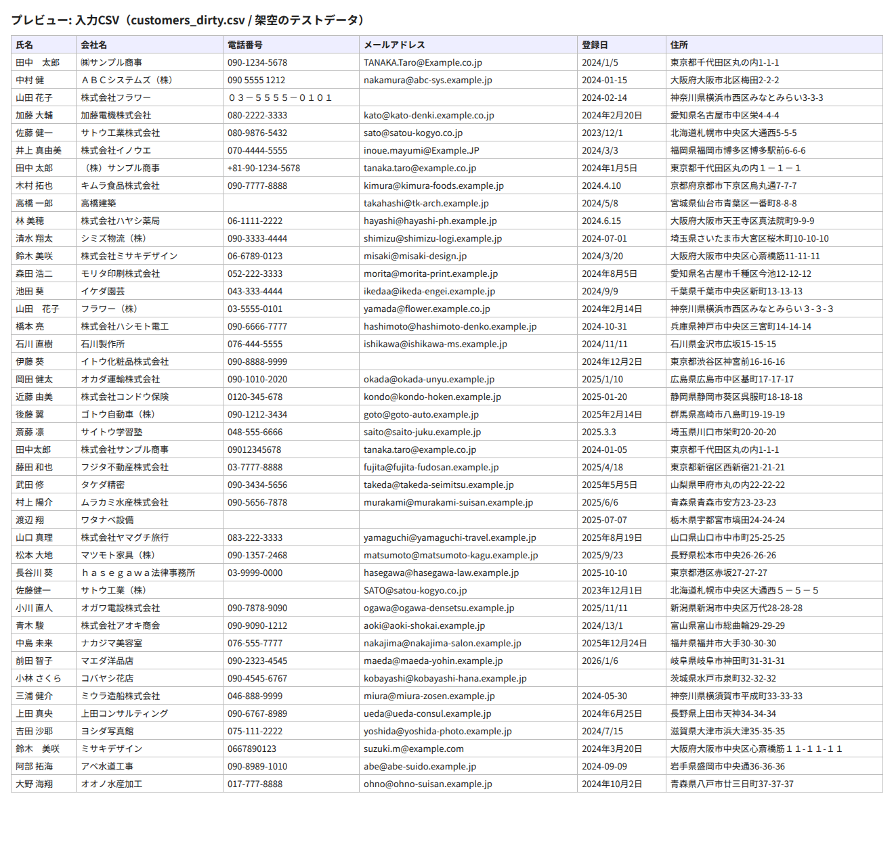
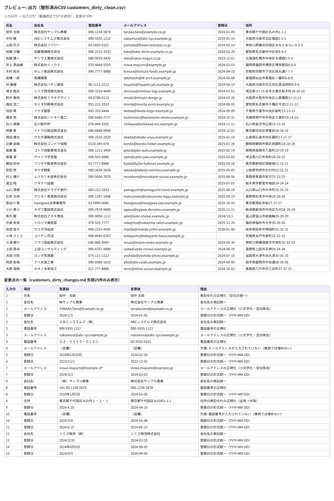

# サンプル② 顧客リストCSV整形ツール（clean_customers.py）

表記ゆれ・重複・欠損のある顧客リストCSVを読み、ルールを決めて機械的に整形し、
**「整形済みのCSV」と「変更点の一覧」をセットで出す**ツールです。

「どこを・なぜ変えたか」が全部一覧に残るので、発注者が検品できます。
欠損は推測で埋めず、一覧に「欠損」として挙げて人の判断に回します。

> **データについての注意**: 同梱の `customers_dirty.csv` は、このツールの動作確認用に
> 作った**架空のテストデータ**です。氏名・会社名・電話番号・メールアドレス・住所は
> すべて実在しない組み合わせで、ドメインは example.jp / example.co.jp / example.com を
> 使っています。実在の企業・個人の情報は含みません。

## 想定する案件像

分野C（データ整形・業務自動化）の提案に添付するためのサンプルです。
「バラバラに集まった顧客リスト・会員リスト・在庫リストを、決まったルールで
整形して、変更履歴つきで納品する」タイプの案件を想定しています。

## 実行方法

Python標準ライブラリのみで書かれているため、追加インストールは不要です
（動作確認: pol-linux の Python 3.14.4）。

```bash
cd samples/csv-cleaner
python3 clean_customers.py customers_dirty.csv
```

実行すると、入力ファイルと同じフォルダに2つのファイルができます。

| 出力 | 内容 |
|---|---|
| `customers_dirty_clean.csv` | 整形済みCSV（正規化済み・重複統合済み） |
| `customers_dirty_changes.md` | 変更点の一覧（Markdown表） |

出力先を変えたい場合は `-o` と `-c` で指定できます。

```bash
python3 clean_customers.py 入力.csv -o 整形済み.csv -c 変更一覧.md
```

想定する入力CSVの列は `氏名, 会社名, 電話番号, メールアドレス, 登録日, 住所` です。
ファイルが無い・空ファイル・ヘッダーが違う場合は、日本語のエラーメッセージを
出して終了します（終了コード1）。ヘッダーのみのファイルは正常終了し、
ヘッダーだけのCSVと「変更点0件」の一覧を出力します。列数が合わない行が
あっても落ちず、不足分を空欄として読み込み、変更一覧に記録します。

## 整形ルール

すべての項目に共通: 前後の空白（半角スペース・タブ・全角スペース）を取り除き、
連続する空白は半角スペース1つにまとめます。

| 項目 | ルール |
|---|---|
| 氏名 | 全角スペースを半角スペースに統一する（例: 「田中　太郎」→「田中 太郎」） |
| 会社名 | 「㈱」「(株)」「（株）」→「株式会社」、「㈲」等→「有限会社」に統一する。英字は半角化するが大文字・小文字は変えない。前株・後株の位置は変えない（「株式会社○○」と「○○株式会社」は別の表記のまま残す） |
| 電話番号 | 全角数字を半角化し、`+81` 表記は先頭の `0` に戻し、ハイフンやスペースを取り除いて数字だけにしてから、整形し直す。11桁（携帯など）は 3-4-4、03/06 は 2-4-4、0120/0800 は 4-3-3、その他の10桁は 3-3-4。判定できない形式は数字のまま出力し、変更一覧に「要確認」と記録する |
| メールアドレス | 前後の空白を取り除き、すべて小文字にする |
| 登録日 | `2024/1/5`、`2024-01-05`、`2024.1.5`、`2024年1月5日` をすべて `2024-01-05` 形式に統一する。日付として解釈できない値（`2024/13/1` など）はそのまま出力し、変更一覧に「要確認」と記録する |
| 住所 | 全角数字・全角ハイフンを半角化する（例: 「丸の内１－１－１」→「丸の内1-1-1」） |

既知の限界: 電話番号の市外局番は、03/06（2桁）と「3桁の市外局番」を前提に
区切っています。4桁の市外局番（例: 0263）は正しく区切れない場合があります。
その代わり、すべての変更が変更一覧に残るため、後から目視で確認できます。

## 重複の統合ルール

次のどちらかを満たす行を「同一人物の重複」とみなします（正規化した後の値で判定）。

1. **メールアドレスが一致**する
2. **電話番号と氏名が両方一致**する

統合のしかた:

- 先に現れた行を代表行として残し、重複行は出力しません
- 代表行で空欄になっている項目は、重複行の値で補います（補ったことも一覧に記録します）
- 両方に値があり内容が違う場合は、代表行の値を優先します
- 統合したことは、変更一覧に「重複統合（メールアドレスが一致）」のように
  理由つきで必ず記録します

割り切り: 家族でメールアドレスを共有している場合なども、ルール1で統合されます。
実務では案件ごとにこのルールを調整します（本ツールは決定的なルールの見本です）。

## 欠損の扱い

氏名・電話番号・メールアドレス・登録日が空欄の行は、**推測で埋めず**、
空欄のまま出力します。その代わり変更一覧に「欠損: ○○が入力されていない
（推測では埋めない）」と記録するので、発注者が後から確認できます。

## 入力例と出力例（プレビュー）

同梱の架空データ（42行）で実行した結果です。実際の入出力CSVをHTMLの表にして
撮影したプレビュー画像です（画像内のデータもすべて架空です）。

- 入力: 42行 → 出力: **37行**（重複統合で5行を統合）
- 変更点の一覧: **70件**

入力CSV（整形前）:



整形済みCSVと変更点の一覧（先頭25件）:



生成物そのものも同梱しています: `customers_dirty_clean.csv`、
`customers_dirty_changes.md`。プレビューの元HTMLは `preview_input.html`、
`preview_output.html` です。

## ファイル構成

| ファイル | 内容 |
|---|---|
| `clean_customers.py` | 本体（Python標準ライブラリのみ） |
| `customers_dirty.csv` | テスト用入力データ（架空・42行） |
| `customers_dirty_clean.csv` | 実行で生成された整形済みCSV（生成物） |
| `customers_dirty_changes.md` | 実行で生成された変更点の一覧（生成物） |
| `preview_input.png` / `preview_output.png` | 入出力のプレビュー画像 |
| `preview_input.html` / `preview_output.html` | プレビューの元HTML |
